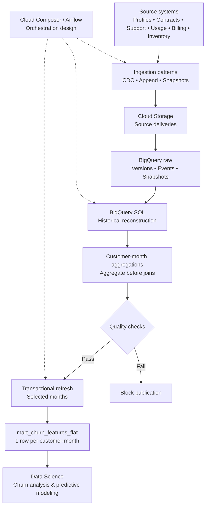

# Customer Churn Feature Mart | GCP Data Engineering

**Data Engineering portfolio project — BigQuery SQL, historical data modeling, data quality, and cloud architecture.**

## From business need to data product

**Business objective: equip Data Science teams with reliable customer information to investigate and predict churn, helping a telecommunications business identify customers who may be at risk of leaving.**

Telecommunications companies collect customer information across multiple operational systems: profiles, subscriptions, internet usage, invoices, support interactions, service requests, inventory, and geography. Each source describes a different part of the customer experience, follows its own delivery schedule, and may change over time.

**The Data Engineering challenge is to convert these disconnected records into comparable, historically meaningful customer features.** A Data Science team needs a coherent analytical dataset—not eight unrelated raw tables with different grains, changing records, and possible duplicates.

## Turning business questions into data requirements

I translated this need into a BigQuery feature mart, **`mart_churn_features_flat`**, with **one row per customer per calendar month**.

| Business question the data can help investigate | Data Engineering response |
| --- | --- |
| Are technical problems and unresolved support cases associated with churn? | Monthly support-ticket counts, first-contact resolution indicators, and satisfaction measures. |
| Could billing difficulties be associated with customers leaving? | Late-payment and overdue-invoice indicators. |
| How do service usage and active subscriptions relate to customer behavior? | Monthly usage totals and contracts active at each month-end. |
| What was actually known about a customer at the time under analysis? | Historical version selection using availability timestamps and dated snapshots. |
| Can customers be compared across months without inflated figures? | A consistent customer-month grain, source-level aggregation before joins, and quality checks. |

These features help Data Science teams **explore churn patterns and build predictive models**. They are not presented as proven causes of churn.

## My Data Engineering contribution

I developed the **BigQuery Standard SQL** transformation that reconstructs the relevant historical customer states, aggregates operational activity to the monthly grain, and combines the prepared features into a single analytical table.

The SQL also includes checks for source readiness, historical version conflicts, valid customer-month keys, row-count preservation, time-window boundaries, and nonnegative tenure. Parameterized periods support targeted historical reprocessing, and a transaction replaces selected months without leaving a partial publication.

I also designed the supporting **GCP data architecture**, connecting source-specific ingestion patterns, Cloud Storage retention, BigQuery transformations, and Airflow orchestration responsibilities.

## What this demonstrates to an employer

**I can start with a business problem, identify the relevant data, define an analytical grain, engineer historically consistent features, and validate the resulting data product for its intended consumers.**

That is the contribution a Data Engineer can bring to a business team: turning operational data into a dependable foundation for analytics and decision-making.

This project demonstrates the engineering approach and deliverables. It does not claim measured churn reduction, financial impact, or a deployed prediction model.

## Engineering highlights

- **BigQuery SQL transformations:** customer-month spine, source-level aggregations, and controlled joins at a consistent grain.
- **Historical data modeling:** version selection using `_ingested_at`, month-end observation rules, and dated inventory/geography snapshots.
- **Data quality controls:** `ASSERT` checks for source readiness, date parameters, conflicting source versions, valid keys, unique customer-month records, row-count preservation, month bounds, and nonnegative tenure.
- **Repeatable historical processing:** parameterized month ranges support targeted backfills.
- **Atomic publication:** transactional `DELETE` + `INSERT` replaces selected months without exposing partial updates.
- **Query efficiency:** partitioning by `billing_month` and clustering by `customer_id`.
- **GCP architecture design:** source ingestion patterns, Cloud Storage retention, BigQuery raw and transformation layers, and managed Airflow orchestration.

## Architecture

The diagram below shows the end-to-end flow from operational systems to the monthly feature mart, ready for Data Science consumption.

[Explore the GCP architecture (PDF)](architecture/gcp_customer_churn_architecture.pdf)

The design connects three source delivery patterns—change capture, append feeds, and full snapshots—to a BigQuery transformation pipeline. Cloud Storage provides a raw-delivery retention layer; Airflow coordinates dependencies, retry policies, source readiness, and backfills.

## Data model

The source specifications cover eight business domains: customer profiles, subscriptions, usage, invoices, support interactions, orders, service inventory, and geography.

The resulting monthly feature table includes customer tenure, customer type, credit score, usage volume, active contracts, payment behavior, support activity, satisfaction measures, failed requests, and service-location information.

[Explore source tables and columns (Excel)](docs/source_data_specifications.xlsx)

## Repository contents

| Path | Contents |
| --- | --- |
| [`sql/mart_churn_features_flat.sql`](sql/mart_churn_features_flat.sql) | BigQuery Standard SQL transformations, validations, and transactional publication |
| [`architecture/gcp_customer_churn_architecture.pdf`](architecture/gcp_customer_churn_architecture.pdf) | GCP data architecture and orchestration design |
| [`docs/historical_changes_and_resilience.pdf`](docs/historical_changes_and_resilience.pdf) | Historical-data management and recovery decisions |
| [`docs/source_data_specifications.xlsx`](docs/source_data_specifications.xlsx) | Source schemas, fields, and ingestion characteristics |

## Executing the SQL

The script expects raw BigQuery tables containing the fields defined in the specifications, including ingestion metadata such as `_ingested_at` and snapshot dates where applicable.

1. Set the `PROJECT_ID`, `RAW_DATASET`, and `MART_DATASET` identifiers in the script.
2. Provide `start_month` and `end_month` as BigQuery `DATE` parameters, both set to the first day of their respective calendar months.
3. Provide `sources_ready` as a `BOOL` after confirming the required input deliveries.
4. Execute the complete script in BigQuery Standard SQL outside session mode.

For example, `start_month = DATE '2026-07-01'` and `end_month = DATE '2026-07-01'` selects all of July 2026. The script calculates the exclusive upper bound using `DATE_ADD(end_month, INTERVAL 1 MONTH)`.
