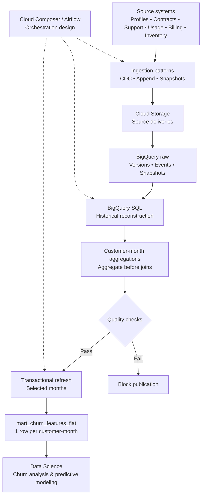

# Customer Churn Feature Mart | GCP Data Engineering

**Business objective:** Prepare reliable customer data so Data Science teams can investigate and predict customer churn in telecommunications.

The challenge is combining customer profiles, contracts, service usage, payments, support, orders and service inventory into **one historically consistent customer-month feature table** for analytics.

## Business need → Data Engineering delivery

| Business need | Data engineering approach |
| --- | --- |
| Identify patterns associated with customer departures | Assemble behavioral, billing and service features |
| Compare customers month by month | One row per customer per calendar month |
| Avoid using future information | Select historical records based on observation cutoffs and ingestion timestamps |
| Trust the resulting feature table | Validate source versions, uniqueness, row counts and calendar bounds |
| Refresh or correct historical periods | Transactional publication and targeted backfills |

## GCP Data Architecture

The architecture is displayed **directly below**, without having to open the PDF:

The detailed diagram is available as a PDF in the project materials.

## My contribution

I developed the **BigQuery Standard SQL** transformation for the monthly feature mart: historical state reconstruction, monthly event aggregation, point-in-time feature assembly, data-quality assertions, partitioning by billing month, clustering by customer, and transactional month-range replacement.

I designed the surrounding GCP ingestion and orchestration architecture to communicate how source systems would feed the analytics layer.

## What this demonstrates

**I can translate a company's business question into data requirements, choose the right analytical grain, engineer consistent historical features, and deliver validated data ready for Data Science teams.**

The feature mart is the Data Engineering output. No trained churn model or quantified business impact is claimed.
